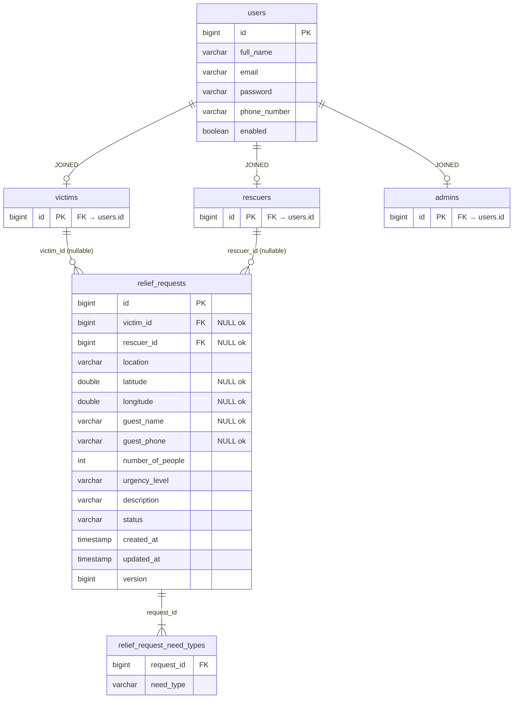

# DATABASE — Cơ sở dữ liệu Cần cứu trợ

**Điều hướng:** [README](../README.md) · [SPEC](SPEC.md) · [Kiến trúc](ARCHITECTURE.md) · [OOP Design](OOP-DESIGN.md) · [Workflow](WORKFLOW.md) · [Routes](ROUTES.md) · [User Guide](USER-GUIDE.md) · [Testing](TESTING.md)

---

## 1. Tổng quan

- Database: **PostgreSQL** (Neon serverless).
- ORM: Hibernate, `ddl-auto=update` — Hibernate tự tạo/cập nhật bảng khi khởi động.
- Mỗi thành viên phát triển trên một **Neon branch riêng**.
- Schema dùng chung nhưng dữ liệu độc lập giữa các branch.

---

## 2. Chiến lược kế thừa (JOINED)

`User` khai báo `@Inheritance(strategy = InheritanceType.JOINED)`. Hibernate tạo 4 bảng:

| Bảng | Nội dung |
|---|---|
| `users` | Bảng cha: `id`, `full_name`, `email`, `password`, `phone_number`, `enabled` |
| `victims` | Bảng con: chỉ có `id` (FK → `users.id`) |
| `rescuers` | Bảng con: chỉ có `id` (FK → `users.id`) |
| `admins` | Bảng con: chỉ có `id` (FK → `users.id`) |

Khi query `Victim`, Hibernate tự JOIN `victims` với `users`.

---

## 3. Các bảng và cột chính

### Bảng `users`

| Cột | Kiểu | Ràng buộc | Mô tả |
|---|---|---|---|
| `id` | BIGINT | PK, AUTO_INCREMENT | Khóa chính |
| `full_name` | VARCHAR | NOT NULL | Họ tên |
| `email` | VARCHAR | NOT NULL, UNIQUE | Email đăng nhập |
| `password` | VARCHAR | NOT NULL | BCrypt hash |
| `phone_number` | VARCHAR | NOT NULL | Số điện thoại |
| `enabled` | BOOLEAN | NOT NULL, default true | Tài khoản hoạt động / bị khóa |

### Bảng `victims`, `rescuers`, `admins`

| Cột | Kiểu | Ràng buộc |
|---|---|---|
| `id` | BIGINT | PK, FK → `users.id` |

### Bảng `relief_requests`

| Cột | Kiểu | Ràng buộc | Mô tả |
|---|---|---|---|
| `id` | BIGINT | PK, AUTO_INCREMENT | Khóa chính |
| `victim_id` | BIGINT | FK → `victims.id`, NULL được | Null khi là yêu cầu SOS khách |
| `rescuer_id` | BIGINT | FK → `rescuers.id`, NULL được | Null khi chưa được nhận |
| `location` | VARCHAR | NOT NULL | Địa điểm dạng text |
| `latitude` | DOUBLE | NULL | Vĩ độ GPS (tùy chọn) |
| `longitude` | DOUBLE | NULL | Kinh độ GPS (tùy chọn) |
| `guest_name` | VARCHAR(100) | NULL | Tên khách SOS (khi victim_id = null) |
| `guest_phone` | VARCHAR(20) | NULL | SĐT khách SOS (khi victim_id = null) |
| `number_of_people` | INT | NOT NULL | Số người cần hỗ trợ |
| `urgency_level` | VARCHAR | NOT NULL | Enum: LOW/MEDIUM/HIGH/CRITICAL |
| `description` | VARCHAR(1000) | NULL | Mô tả chi tiết |
| `status` | VARCHAR | NOT NULL, default SENT | Enum: SENT/ACCEPTED/PROCESSING/COMPLETED/CONFIRMED/CANCELLED |
| `created_at` | TIMESTAMP | NOT NULL | Thời gian tạo (set lúc khởi tạo object) |
| `updated_at` | TIMESTAMP | NULL | Thời gian cập nhật cuối (`@PreUpdate`) |
| `version` | BIGINT | NULL | Optimistic locking (`@Version`) |

### Bảng `relief_request_need_types` (quan hệ nhiều-nhiều)

| Cột | Kiểu | Ràng buộc | Mô tả |
|---|---|---|---|
| `request_id` | BIGINT | FK → `relief_requests.id` | Khóa ngoại |
| `need_type` | VARCHAR | NOT NULL | Enum: FOOD/WATER/MEDICAL/SHELTER/RESCUE/OTHER |

Một yêu cầu có thể có nhiều loại nhu cầu. Được ánh xạ bằng `@ElementCollection` + `@CollectionTable` trên `ReliefRequest.needTypes`.

---

## 4. Quan hệ giữa các bảng

| Quan hệ | Loại | Ghi chú |
|---|---|---|
| `victims.id` → `users.id` | Kế thừa JOINED | |
| `rescuers.id` → `users.id` | Kế thừa JOINED | |
| `admins.id` → `users.id` | Kế thừa JOINED | |
| `relief_requests.victim_id` → `victims.id` | ManyToOne, nullable | NULL = SOS từ khách |
| `relief_requests.rescuer_id` → `rescuers.id` | ManyToOne, nullable | NULL = chưa được nhận |
| `relief_request_need_types.request_id` → `relief_requests.id` | ElementCollection | |

---

## 5. Yêu cầu SOS (victim_id = null)

Khi khách vãng lai gửi SOS:
- `victim_id = NULL` (thay vì NOT NULL).
- `guest_name` và `guest_phone` lưu thông tin liên lạc thay thế.
- `urgency_level = CRITICAL`, `need_type = RESCUE`.

> **Lưu ý migration:** Cột `victim_id` ban đầu có thể có ràng buộc NOT NULL. File [`docs/migration-need-types.sql`](migration-need-types.sql) xử lý việc chuyển đổi `need_type` (cột đơn sang bảng nhiều-nhiều); NOT NULL của `victim_id` được Hibernate xử lý qua `ddl-auto=update`.

---

## 6. File migration SQL

| File | Mô tả |
|---|---|
| [`migration-need-types.sql`](migration-need-types.sql) | Chuyển cột `need_type` (STRING đơn) sang bảng `relief_request_need_types` (nhiều-nhiều). Cần chạy trên mỗi Neon branch có dữ liệu cũ, **sau khi** app đã khởi động ít nhất 1 lần. |

---

## 7. Sơ đồ ER

