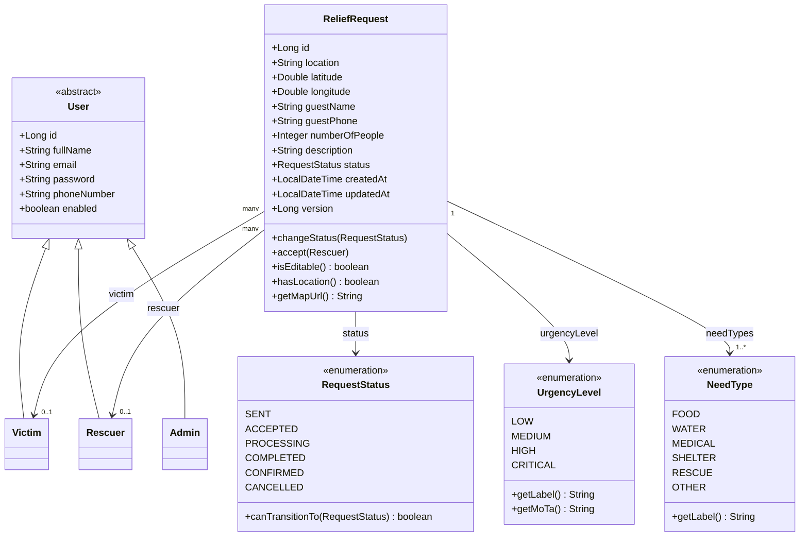

# OOP-DESIGN — Thiết kế hướng đối tượng

> Tài liệu này phân tích thiết kế OOP của dự án **Cần cứu trợ**, chỉ ra bằng ví dụ thật trong code (tên class, phương thức, đường dẫn file) để minh họa bốn tính chất OOP và các nguyên tắc thiết kế đã áp dụng.

**Điều hướng:** [README](../README.md) · [SPEC](SPEC.md) · [Kiến trúc](ARCHITECTURE.md) · [Database](DATABASE.md) · [Workflow](WORKFLOW.md) · [Routes](ROUTES.md) · [User Guide](USER-GUIDE.md) · [Testing](TESTING.md)

---

## 1. Kế thừa (Inheritance)

### Cây kế thừa User

```
User (abstract)  →  bảng "users"    [model/User.java]
  ├── Victim     →  bảng "victims"  [model/Victim.java]
  ├── Rescuer    →  bảng "rescuers" [model/Rescuer.java]
  └── Admin      →  bảng "admins"   [model/Admin.java]
```

**Chiến lược ánh xạ JPA:** `InheritanceType.JOINED`

```java
// src/main/java/com/reliefcoordination/relief_coordination/model/User.java
@Entity
@Table(name = "users")
@Inheritance(strategy = InheritanceType.JOINED)  // Mỗi lớp con một bảng riêng
public abstract class User {
    @Id @GeneratedValue(strategy = GenerationType.IDENTITY)
    private Long id;
    private String fullName;
    @Column(unique = true) private String email;
    private String password;
    private String phoneNumber;
    private boolean enabled = true;
}
```

**Lớp con:** Victim, Rescuer, Admin chỉ kế thừa `User`, không thêm trường riêng (hiện tại). Bảng con chỉ chứa khóa ngoại trỏ về `users.id`.

```java
// src/main/java/com/reliefcoordination/relief_coordination/model/Victim.java
@Entity
@Table(name = "victims")
public class Victim extends User { }
```

**Lợi ích thực tế:** `ReliefRequest` có thể khai báo `@ManyToOne Victim victim` và `@ManyToOne Rescuer rescuer` thay vì dùng role string; Security Service dùng `instanceof` để gán role chính xác:

```java
// src/main/java/com/reliefcoordination/relief_coordination/security/CustomUserDetailsService.java
String role;
if (user instanceof Admin)   role = "ROLE_ADMIN";
else if (user instanceof Rescuer) role = "ROLE_RESCUER";
else                         role = "ROLE_VICTIM";
```

---

## 2. Đóng gói (Encapsulation)

### 2.1. Private field + Getter/Setter qua Lombok

Tất cả field của entity đều `private`. `@Getter @Setter` (Lombok) sinh getter/setter; `@Column(nullable=false)` là ràng buộc JPA.

```java
// model/ReliefRequest.java
@Getter @Setter
public class ReliefRequest {
    @Id private Long id;
    private String location;
    // ...
    @Setter(AccessLevel.NONE)   // ← Setter bị khóa!
    private RequestStatus status = RequestStatus.SENT;
}
```

### 2.2. Bảo vệ trạng thái qua phương thức nghiệp vụ

Field `status` bị khóa setter (`@Setter(AccessLevel.NONE)`). Trạng thái **chỉ thay đổi được** qua:

```java
// model/ReliefRequest.java

/** Chỉ cho phép bước chuyển hợp lệ; ném IllegalStateException nếu sai. */
public void changeStatus(RequestStatus next) {
    Objects.requireNonNull(next, "Trạng thái mới không được null");
    if (!this.status.canTransitionTo(next)) {
        throw new IllegalStateException(
            "Không thể chuyển từ " + this.status + " sang " + next);
    }
    this.status = next;
}

/** Rescuer nhận yêu cầu: kiểm tra bước đi trước, gán rescuer sau. */
public void accept(Rescuer rescuer) {
    Objects.requireNonNull(rescuer, "Rescuer không được null");
    changeStatus(RequestStatus.ACCEPTED);
    this.rescuer = rescuer;
}
```

### 2.3. Validation tại tầng DTO/Form

`ReliefRequestForm` và `EmergencyRequestDto` dùng Bean Validation để bảo vệ dữ liệu đầu vào:

```java
// dto/ReliefRequestForm.java
@NotBlank(message = "Địa điểm không được để trống")
private String location;

@NotEmpty(message = "Vui lòng chọn ít nhất một loại nhu cầu")
private Set<NeedType> needTypes = new HashSet<>();

@NotNull @Min(1)
private Integer numberOfPeople;
```

```java
// dto/EmergencyRequestDto.java
@Pattern(
    regexp = "^(0[3-9]\\d{8}|\\+84[3-9]\\d{8})$",
    message = "Số điện thoại không hợp lệ"
)
private String phoneNumber;
```

### 2.4. Phương thức truy vấn trạng thái (query method)

```java
// model/ReliefRequest.java
public boolean isEditable()  { return this.status == RequestStatus.SENT; }
public boolean hasLocation() { return latitude != null && longitude != null; }
public String  getMapUrl()   { /* null nếu không có GPS */ }
```

---

## 3. Đa hình (Polymorphism)

### 3.1. Đa hình qua kế thừa — `CurrentUserService`

```java
// service/CurrentUserService.java
public User getCurrentUser(Authentication auth) { /* ... */ }
public Victim  getCurrentVictim(Authentication auth)  { return as(getCurrentUser(auth), Victim.class); }
public Rescuer getCurrentRescuer(Authentication auth) { return as(getCurrentUser(auth), Rescuer.class); }
public Admin   getCurrentAdmin(Authentication auth)   { return as(getCurrentUser(auth), Admin.class); }

private <T extends User> T as(User user, Class<T> type) {
    if (!type.isInstance(user))
        throw new IllegalStateException("Người dùng không phải " + type.getSimpleName());
    return type.cast(user);
}
```

Phương thức `getCurrentVictim/getCurrentRescuer/getCurrentAdmin` xử lý giống nhau nhưng trả về đúng kiểu — đa hình thông qua generic bounded wildcard.

### 3.2. Đa hình qua `switch` trên kiểu enum

```java
// service/AdminService.java — toggleKhoa()
User user = switch (loai) {
    case "victim"  -> victimRepository.findById(id)...;
    case "rescuer" -> rescuerRepository.findById(id)...;
    default -> throw new IllegalArgumentException("Loại không hợp lệ: " + loai);
};

if (user instanceof Rescuer r) { /* xử lý riêng cho Rescuer (có lockedRescuerIds) */ }
else                           { user.setEnabled(!user.isEnabled()); }
```

### 3.3. Đa hình giao diện Spring (`JpaRepository`)

Mỗi repository interface kế thừa `JpaRepository<T, Long>`:

```java
// repository/ReliefRequestRepository.java
public interface ReliefRequestRepository extends JpaRepository<ReliefRequest, Long> {
    List<ReliefRequest> findByStatus(RequestStatus status);
    Page<ReliefRequest> timKiemYeuCauAdmin(...);
    // ...
}
```

Spring Data tự sinh implementation lúc runtime — đây là đa hình qua interface (dependency inversion).

---

## 4. Trừu tượng (Abstraction)

### 4.1. `User` là abstract class

```java
// model/User.java
public abstract class User { ... }
```

Không `new User()` trực tiếp — phải tạo qua lớp con (`new Victim()`, `new Rescuer()`, `new Admin()`). Đây là trừu tượng hóa khái niệm "người dùng", buộc hệ thống phải làm việc với vai trò cụ thể.

### 4.2. Interface `JpaRepository` và `ErrorController`

`ReliefRequestRepository`, `UserRepository`, ... đều là interface — ẩn hoàn toàn chi tiết truy vấn SQL.

`ErrorPageController` implements `ErrorController` (Spring Boot interface) để tùy biến trang lỗi:

```java
// controller/ErrorPageController.java
public class ErrorPageController implements ErrorController {
    @RequestMapping("/error")
    public String handleError(HttpServletRequest request, Model model) { ... }
}
```

### 4.3. Record DTO — trừu tượng hóa dữ liệu thống kê

```java
// dto/PublicStatsDto.java
public record PublicStatsDto(
    long totalRequests,
    long completedRequests,
    long totalPeopleSupported
) {
    public static PublicStatsDto empty() { return new PublicStatsDto(0L, 0L, 0L); }
}
```

`PublicStatsDto` và `AdminService.AdminStats` (record lồng) trừu tượng hóa dữ liệu thống kê, tách logic tính toán (Service) khỏi layer hiển thị (Controller/Template).

---

## 5. Enum có hành vi

### 5.1. `RequestStatus` — hành vi chuyển trạng thái

```java
// model/RequestStatus.java
public enum RequestStatus {
    SENT, ACCEPTED, PROCESSING, COMPLETED, CONFIRMED, CANCELLED;

    private static final Map<RequestStatus, Set<RequestStatus>> ALLOWED_TRANSITIONS = Map.of(
        SENT,       Set.of(ACCEPTED, CANCELLED),
        ACCEPTED,   Set.of(PROCESSING, CANCELLED),
        PROCESSING, Set.of(COMPLETED, CANCELLED),
        COMPLETED,  Set.of(CONFIRMED, CANCELLED),
        CONFIRMED,  Set.of(),
        CANCELLED,  Set.of()
    );

    public boolean canTransitionTo(RequestStatus next) {
        return ALLOWED_TRANSITIONS.get(this).contains(next);
    }
}
```

`canTransitionTo()` đóng gói quy tắc nghiệp vụ ngay trong enum, đảm bảo mọi nơi dùng cùng một bộ quy tắc.

### 5.2. `UrgencyLevel` — label và mô tả

```java
// model/UrgencyLevel.java
public enum UrgencyLevel {
    LOW("Thấp", "Chưa nguy hiểm, có thể chờ vài ngày"),
    MEDIUM("Trung bình", "Đang thiếu thốn, cần hỗ trợ trong ngày"),
    HIGH("Cao", "Có nguy cơ về sức khỏe, cần trong vài giờ"),
    CRITICAL("Khẩn cấp", "Nguy hiểm đến tính mạng, cần cứu ngay");

    public String getLabel()  { return label; }
    public String getMoTa()   { return moTa; }
}
```

### 5.3. `NeedType` — label tiếng Việt

```java
// model/NeedType.java
public enum NeedType {
    FOOD("Thực phẩm"), WATER("Nước uống"), MEDICAL("Y tế"),
    SHELTER("Nơi ở"), RESCUE("Cứu người"), OTHER("Khác");

    public String getLabel() { return label; }
}
```

Enum có hành vi giúp template Thymeleaf dùng `${needType.label}` thay vì hard-code chuỗi.

---

## 6. Nguyên tắc tách tầng Service

Mỗi chức năng nghiệp vụ có một Service riêng — không gom vào một Service lớn:

| Service | Chức năng cốt lõi |
|---|---|
| `VictimRequestService` | Tao, sua, huy, xacNhan |
| `RescuerRequestService` | Tìm kiếm SENT, nhanNhiemVu |
| `RescuerTaskService` | capNhatTrangThaiTiep (tự tính bước tiếp theo) |
| `AdminService` | thongKe, duyetRescuer, toggleKhoa, huyYeuCau |
| `EmergencyService` | taoYeuCauSOS, daCoYeuCauDangHoatDong |
| `PublicStatsService` | getPublicStats (cho Landing, không lộ cá nhân) |
| `CurrentUserService` | getCurrentUser/Victim/Rescuer/Admin |

---

## 7. DTO và Form Object

Nguyên tắc: **không bind thẳng Entity vào HTML form**.

| Form / DTO | Dùng trong | Mục đích |
|---|---|---|
| `RegisterForm` | `AuthController` | Đăng ký; kiểm tra trùng email, khớp mật khẩu |
| `ProfileForm` | `ProfileController` | Sửa hồ sơ; xác nhận mật khẩu cũ |
| `ReliefRequestForm` | `VictimController` | Tạo/sửa yêu cầu; có `from(ReliefRequest)` để điền lại form khi sửa |
| `EmergencyRequestDto` | `EmergencyController` | SOS không đăng nhập; validate SĐT regex |
| `PublicStatsDto` | `HomeController` → Landing | Thống kê công khai (Java record) |

---

## 8. Quản lý ngoại lệ

```java
// exception/GlobalExceptionHandler.java  (@ControllerAdvice)
@ExceptionHandler(IllegalStateException.class)
→ redirect về Referer + flash message

@ExceptionHandler(ObjectOptimisticLockingFailureException.class)
→ redirect về Referer + flash "Yêu cầu đã được người khác xử lý"

@ExceptionHandler(AccessDeniedException.class)
→ render error/403

@ExceptionHandler(ResourceNotFoundException.class)
→ render error/404
```

Tách xử lý lỗi ra khỏi Controller — Controller không cần try/catch.

---

## 9. Sơ đồ lớp (Class Diagram)



