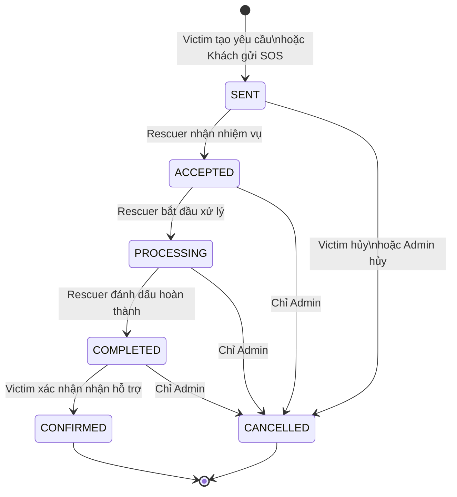
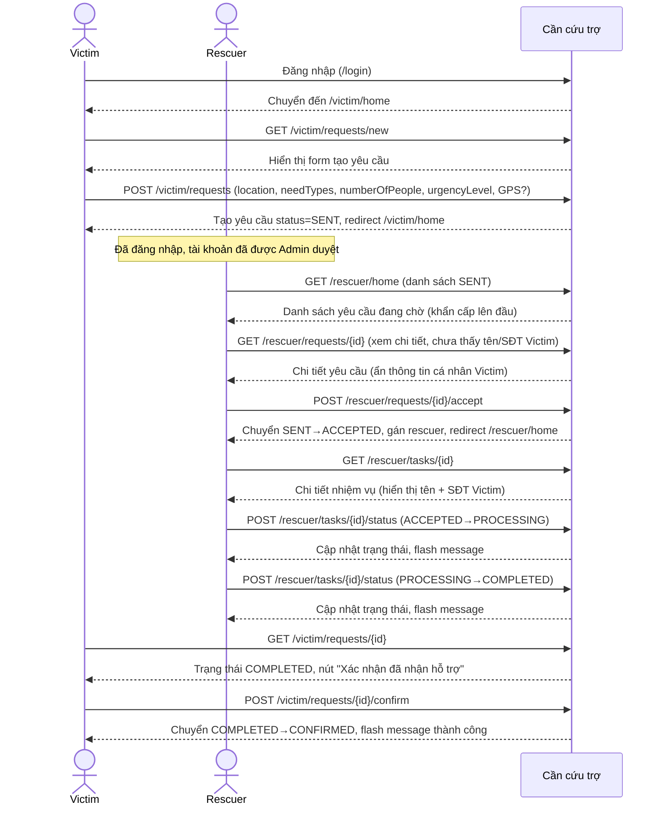
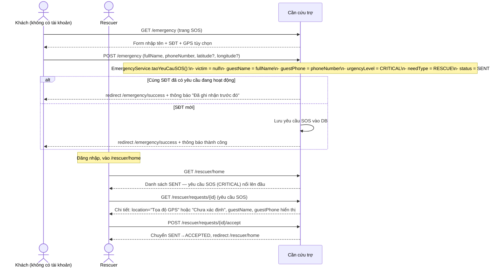
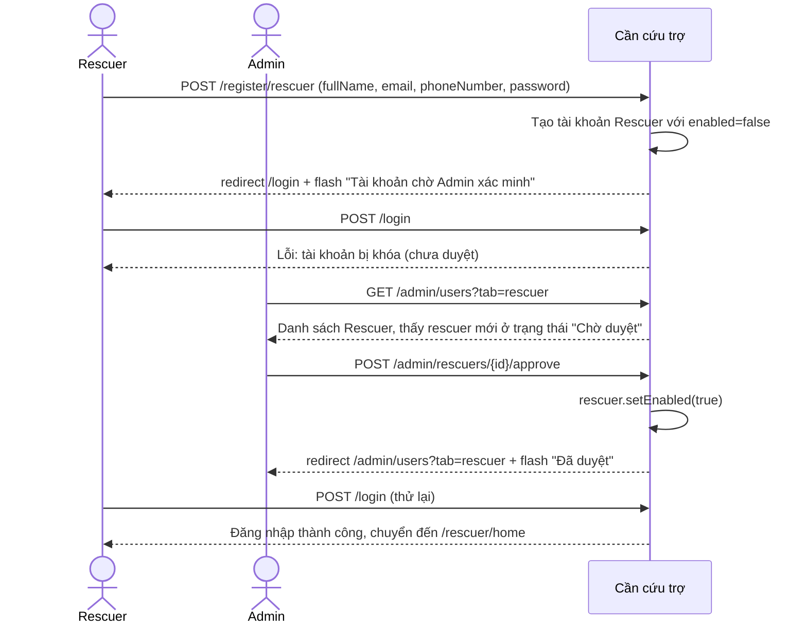

# WORKFLOW — Luồng nghiệp vụ Cần cứu trợ

**Điều hướng:** [README](../README.md) · [SPEC](SPEC.md) · [Kiến trúc](ARCHITECTURE.md) · [OOP Design](OOP-DESIGN.md) · [Database](DATABASE.md) · [Routes](ROUTES.md) · [User Guide](USER-GUIDE.md) · [Testing](TESTING.md)

---

## 1. Sơ đồ trạng thái yêu cầu cứu trợ

**Ghi chú:**
- Trạng thái `CONFIRMED` và `CANCELLED` là trạng thái cuối — không chuyển tiếp.
- Mọi chuyển trạng thái đều qua `request.changeStatus()` → `RequestStatus.canTransitionTo()`.
- `request.accept(rescuer)` gọi `changeStatus(ACCEPTED)` trước rồi gán `rescuer`.

---

## 2. Luồng (a): Victim gửi yêu cầu → Rescuer xử lý → Victim xác nhận

---

## 3. Luồng (b): Khách gửi SOS không cần tài khoản → Rescuer thấy ngay

---

## 4. Luồng duyệt Rescuer (Admin)

